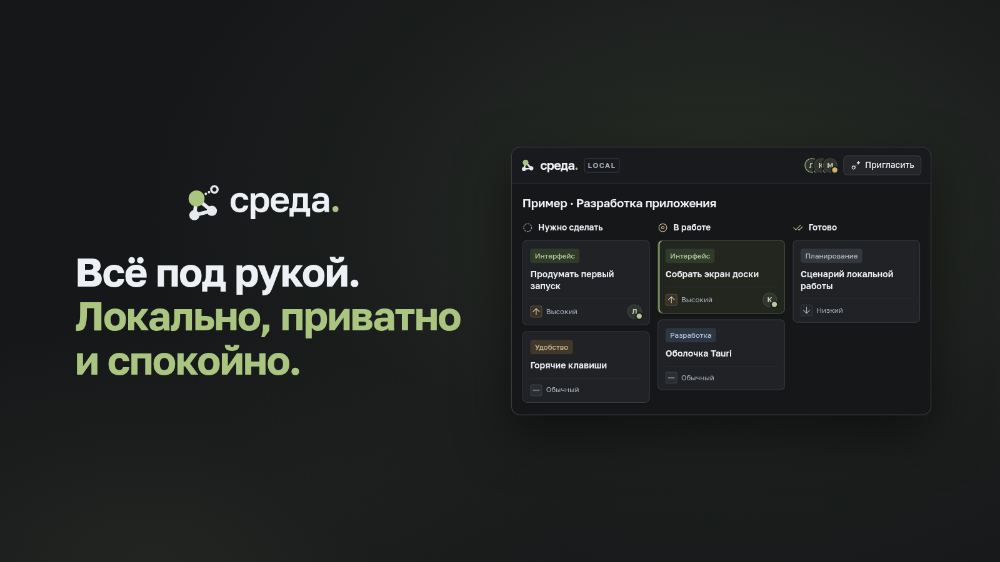

# Sreda

<p align="center">
  
</p>

Local kanban boards and Markdown documents for Windows. Boards, documents, themes and the SQLite database stay on your computer. Collaboration uses an invite link. The MCP server for AI tools is off until you turn it on.

The full guide is in Russian: [README.md](README.md). This page is the short English path.

[](https://github.com/ZAREZOV2/sreda/actions/workflows/ci.yml)
[](https://github.com/ZAREZOV2/sreda/releases/latest)
[](LICENSE)
[](#install)

## Install

Download [Sreda_0.3.0_x64-setup.exe](https://github.com/ZAREZOV2/sreda/releases/download/v0.3.0/Sreda_0.3.0_x64-setup.exe) from the [v0.3.0 release](https://github.com/ZAREZOV2/sreda/releases/tag/v0.3.0). The installer fetches WebView2 if it is missing. Data stays in `%LOCALAPPDATA%\local.sreda.kanban`.

## Build

Windows, Node.js 22.16+, Rust 1.90+ (MSVC), the Visual Studio C++ build tools and WebView2.

```powershell
cd app
npm ci
npm test
npm run typecheck
npm run tauri dev
npm run installer
```

## License

[GPL-3.0-or-later](LICENSE). Bundled fonts stay under the SIL Open Font License 1.1. See [CONTRIBUTING.md](CONTRIBUTING.md), [SECURITY.md](SECURITY.md) and [CODE_OF_CONDUCT.md](CODE_OF_CONDUCT.md).
