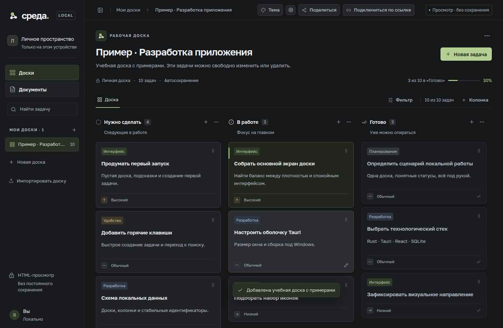
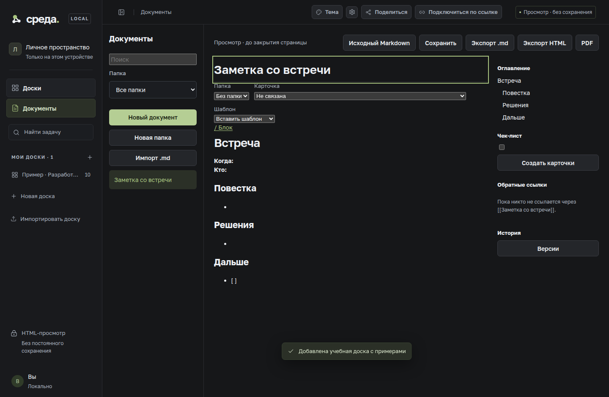
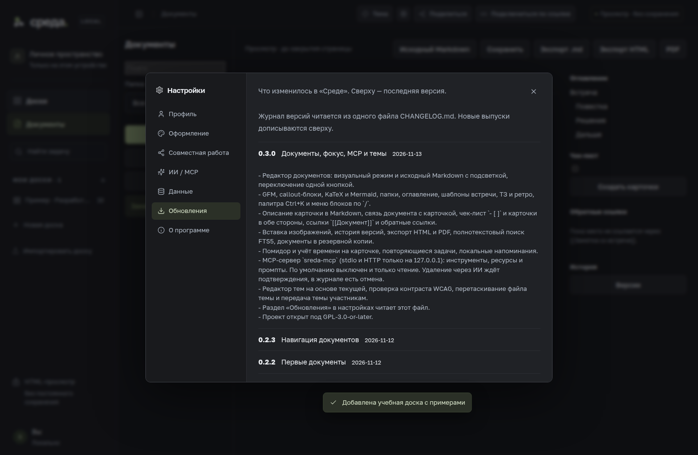

# Среда

<p>
  
</p>

Локальные канбан-доски и Markdown-документы. Всё лежит на вашем компьютере: SQLite, темы, совместная работа по приглашению и, если включите, MCP для ИИ.

[](LICENSE)
[](CHANGELOG.md)
[](#установка)
[](https://tauri.app)

## English

Sreda is a local kanban and Markdown app for Windows. Boards, documents, themes and optional MCP stay on the machine. Collaboration uses an invite link. The project is GPL-3.0-or-later. The rest of this file is in Russian.

## Возможности

- Доски, колонки с типом «нужно сделать / в работе / готово», карточки, метки, приоритет, перетаскивание.
- Документы: визуальный редактор и исходный Markdown, GFM, callout, KaTeX, Mermaid, папки, оглавление, шаблоны, история версий, экспорт HTML и PDF.
- Описание карточки в Markdown, связь документа с карточкой, чек-лист `- [ ]` ↔ карточки, ссылки `[[Документ]]`.
- Полнотекстовый поиск по документам и карточкам (SQLite FTS5).
- Помидор и учёт времени, повторяющиеся задачи, локальные напоминания.
- Темы `*.sreda-theme.json`, редактор «на основе текущей», проверка контраста, перетаскивание файла в окно.
- Совместная работа по ссылке (WebSocket, при желании через ngrok) и передача темы участникам.
- MCP для Claude Desktop и Cursor: по умолчанию выключен, HTTP только на `127.0.0.1`.

## Скриншоты







## Установка

Скачайте установщик `Среда_0.3.0_x64-setup.exe` со [страницы релизов](https://github.com/search?q=sreda&type=repositories). Нужен WebView2: установщик ставит его сам, если его ещё нет. Данные остаются в `%LOCALAPPDATA%\local.sreda.kanban`.

## Сборка из исходников

Windows, Node.js 22.16+, Rust 1.90+ (MSVC), Visual Studio Build Tools с рабочей нагрузкой C++, WebView2.

```powershell
cd app
npm ci
npm test
npm run typecheck
npm run tauri dev
npm run installer
```

`npm run tauri dev` — окно разработки. `npm run installer` собирает NSIS для текущего пользователя, языки ru/en, тихий загрузчик WebView2.

Рядом с приложением собирается `sreda-mcp.exe`. В CI он кладётся в релиз и в установщик как sidecar.

## MCP

В приложении: Настройки → ИИ / MCP. Сервер выключен, пока вы его не включите. Режим по умолчанию — только чтение. HTTP слушает только `127.0.0.1` и требует токен. Удаление через ИИ всегда ждёт подтверждения в журнале, оттуда же можно отменить запись.

Кнопка «Скопировать конфиг» даёт фрагмент для Claude Desktop и Cursor. Для stdio:

```json
{
  "mcpServers": {
    "sreda": {
      "command": "C:\\Path\\To\\sreda-mcp.exe"
    }
  }
}
```

Путь подставляет само приложение. Бинарник читает ту же базу, что и окно. Переменная `SREDA_DB` переопределяет путь к файлу SQLite.

## Темы

Файл `*.sreda-theme.json`: имя, автор, версия, база `dark` или `light`, известные токены и необязательный CSS. Санитайзер отклоняет неизвестные токены и значения с `url(`, `@import`, `javascript:`, `expression(` и тегами. Свою тему можно собрать в настройках, перетащить файл в окно или отправить участникам открытой доски.

## Совместная работа

Кнопка «Поделиться» поднимает локальный WebSocket. Токен ngrok и статический домен необязательны: без них гости в вашей сети подключаются по локальному адресу, а после перезапуска без статического домена нужна новая ссылка. Доска узнаётся по `workspaceId` и `hostId`.

## Структура

```text
app/            React, тесты, src-tauri (Rust, SQLite, совместная работа, MCP)
scripts/        сборка интерфейса и локальный выпуск
docs/           скриншоты
CHANGELOG.md    журнал версий, его же показывает раздел «Обновления»
```

План, который вошёл в 0.3.0, лежит в [app/ROADMAP.md](app/ROADMAP.md). Журнал — в [CHANGELOG.md](CHANGELOG.md).

## Участие

Смотрите [CONTRIBUTING.md](CONTRIBUTING.md). Короткие правки и сообщения об ошибках приветствуются.

## Лицензия

GPL-3.0-or-later. Текст — в [LICENSE](LICENSE).
